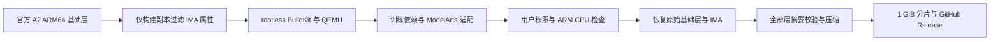

# openPangu RL A2 / ModelArts 训练环境镜像

目标资源为 **512 台 aarch64 服务器，每台 8 张 Ascend 910B3、每卡 64 GiB**，用于云道 / ModelArts 自定义训练作业。镜像标签为 `openpangu-rl-a2-modelarts:2026-10-27`。

本次在 87 上使用现有 rootless Docker、BuildKit 和 QEMU 完成构建，无需 sudo 或管理员权限。成品保存在 `/mnt/sfs_turbo/gyh/openpangu-a2-modelarts/`，分片直接从 87 上传 GitHub。

## 下载与导入

[GitHub Release](https://github.com/gyhthu/openpangu-a2-modelarts/releases/tag/a2-modelarts-20261027)。先下载其中的 `download_release.py` 和 `release_parts.py`，再执行：

```bash
python3 download_release.py https://github.com/gyhthu/openpangu-a2-modelarts/releases/download/a2-modelarts-20261027
python3 release_parts.py join openpangu-image/parts.json openpangu-rl-a2-modelarts.tar.gz
docker load -i openpangu-rl-a2-modelarts.tar.gz
```

下载支持断点续传并校验每片 SHA-256；合并还会校验整个压缩包。分片最大为 1 GiB。下载与合并应预留至少 40 GiB 空间，Docker 导入还需要额外的镜像展开空间。

## 已完成的检查

- Linux ARM64 镜像，默认用户 `ma-user`，UID 1000、GID 100，工作目录 `/home/ma-user`。
- 以 `ma-user` 执行平台启动入口、目录写入和训练依赖存在性检查。
- 完整 `pip check`：`No broken requirements found.`
- ARM CPU 冒烟测试：PyTorch 张量计算、NumPy/OpenCV、Pydantic/FastAPI 请求响应、MCP/FastMCP、W&B、Protobuf 和 xgrammar。
- 最终 Docker tar 共 56 层，全部压缩 blob 摘要和展开层摘要校验通过。
- 原始 A2 基础镜像的 26 层恢复为字节一致的官方内容，包含原始 IMA 属性。

详细证据见附件中的 `image-static-check.json`、`image-runtime-smoke.json`、`image-pip-check.txt`、`archive-verification.json`、`base-restoration.json` 和库文件清理报告。

**尚未执行 910B3、NPU 算子、HCCL 或 512 节点训练测试。** 这是训练环境镜像，不包含模型权重、数据或已验证的 Pro 505B 并行训练配置。训练平台提供 NPU 驱动；实际驱动兼容性和云道定制要求须在目标资源池验收。本次不推送或注册 SWR。

首次自定义训练作业可在各节点执行 8 卡基础计算检查：

```bash
bash /opt/modelarts/run.sh python3 /opt/modelarts/preflight.py --npu
```

正式训练使用自己的入口：

```bash
bash /opt/modelarts/run.sh bash "${MA_JOB_DIR}/your-code/your_train_script.sh"
```

训练入口负责 Ray 集群、Actor/Rollout/Reference 分配、并行参数、退出码传播和清理。原仓库的 92B / 6 台 A3 示例不能直接视为 505B / 512 台 A2 配置。

## ModelArts 适配

启动脚本加载 CANN、NNAL 和算子环境，再执行平台传入的命令；清除基础镜像继承的推理 ENTRYPOINT。缓存、日志与输出目录由 `ma-user` 写入，`PYTHONUNBUFFERED=1`。

| 平台变量 | 训练入口获得的变量 |
|---|---|
| `MA_NUM_HOSTS` / `VC_WORKER_NUM` | `OMNIRL_NUM_HOSTS` |
| `VC_TASK_INDEX` | `OMNIRL_NODE_RANK` |
| `MA_NUM_GPUS` | `OMNIRL_NPUS_PER_NODE` |
| `VC_WORKER_HOSTS` 第一个地址 | `OMNIRL_MASTER_ADDR` |

平台 `MA_*` 变量保持不变。节点数不写死为 512。NNAL 显式选择已通过 PyTorch 检查的 CXX11 ABI，避免自动探测与严格退出选项冲突。

## 构建与版本记录



基础镜像固定为：

```text
swr.cn-east-4.myhuaweicloud.com/omni-ci/omniinfer-a2-arm@sha256:f9b2a41e8b3ffb85a34d9d79715e6ab694d48e571ccd6ed43756c007ccada992
```

对应 tag 为 `release_1.1.0.post1_open-202609221413-vllm`。基础软件包括 CANN 8.5.1、torch 2.9.0、torch-npu 2.9.0.post1.dev20260826；另外安装 NNAL 8.5.0 与 MindIO TTP 7.2rc1。完整 Python 版本见 `image-pip-freeze.txt`。

| 源码 | 固定 commit |
|---|---|
| openPangu-2.0-RL | a1c6793609b6830a6aafb70de415be2bf0385685 |
| openPangu-2.0-Training | a80a8dab1001fc76a15e923aa38eb579093f5504 |
| openPangu-2.0-Infer | 50ebd8a8da10f214528c26d869de8a46acebc6e1 |
| VERL | f9c855f7cf04d603c9546bc01776c74806a879c1 |

实际构建配方见 `Dockerfile.actual-build`。87 上执行的脚本为 `tools/build_ready.sh`；源码在 `source/`，原始 OCI 在 `images/a2-base-oci/`，构建副本在 `images/a2-rootless-oci/`。`build_rootless_on_87.sh` 记录同一流程，要求已有这些输入和专用 BuildKit 容器。

`prepare_rootless_base.py` 仅过滤构建副本中的 122 个 IMA 属性；`restore_official_base.py` 在导出后恢复原始基础层；`verify_archive.py` 校验完整归档。`prefetch_wheels.py` 可根据三个 wheel manifest 预下载并校验所需 ARM 包。

## A2 依赖调整

A2 基础镜像中的 vLLM 要求与 RL 源码的部分精确版本冲突，因此修改 `setup.py` 和 `pyproject.toml` 后重新构建 RL wheel，版本为 **`2.0+modelarts.a2.1`**：

- Protobuf 调整为 6.33.5，Pydantic 为 2.13.5，pydantic-core 为 2.46.5；保留上游 OpenTelemetry 1.39.1。
- W&B 为 0.28.0，Starlette 为 0.49.3；xgrammar 调整为 vLLM 声明要求的 0.1.29。
- 补充 TensorBoard，修复日志、测试和 OpenCV 等辅助依赖，完整清单见 `compat-requirements.txt`。
- 清理基础镜像残留的 MCP/W&B 等不兼容模块，逐文件对照已验证 SHA-256 的官方 wheel；不通过编辑已安装包的元数据掩盖冲突。

这些调整不修改 PyTorch、torch-npu、CANN 或昇腾自定义算子的二进制版本。所有检查范围以随镜像发布的报告为准。

## 官方依据

- [openPangu RL 源码](https://gitcode.com/ascend-tribe/openPangu-2.0-RL)
- [ModelArts 镜像迁移与用户约束](https://support.huaweicloud.com/docker-modelarts/docker-modelarts_0029.html)
- [ModelArts 训练镜像约束](https://support.huaweicloud.com/docker-modelarts/develop-modelarts-10079.html)
- [训练容器环境变量](https://support.huaweicloud.com/develop-modelarts/develop-modelarts-0104.html)
- [自定义训练作业](https://support.huaweicloud.com/develop-modelarts/develop-modelarts-0006.html)
